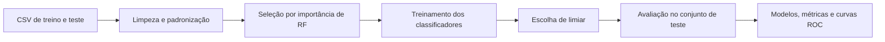

# Classificação molecular em R

**Um experimento de aprendizado de máquina para comparar classificadores sobre descritores moleculares.**

Projeto acadêmico inspirado no trabalho InterDIA, voltado à classificação de autoimunidade induzida por fármacos. Os scripts usam descritores RDKit já disponíveis em CSV e comparam Random Forest, SVM radial, rede neural, Gradient Boosting e um ensemble de florestas balanceadas.

> Esta é uma adaptação experimental em R, não uma reprodução metodologicamente equivalente ao artigo nem uma ferramenta validada para decisões clínicas.

[Pipeline](#pipeline) · [Executar](#executar) · [Resultados](#resultados-históricos) · [Arquivos](#arquivos-principais) · [Reprodutibilidade](#reprodutibilidade-e-limites)

## Pipeline



O script principal remove `SMILES`, converte `Label` para `Classe0`/`Classe1`, remove atributos com baixa variância ou dados ausentes e reduz correlações acima de 0,9. Depois padroniza os descritores e seleciona até 65 atributos pela importância de um Random Forest.

Os classificadores utilizam configurações de validação cruzada e tratamento do desbalanceamento. O ensemble identificado no código como EEC combina **20 Random Forests** treinados em subconjuntos balanceados por undersampling e calcula a média de suas probabilidades. Isso não é a mesma coisa que demonstrar equivalência ao Easy Ensemble do artigo.

## Dados

| Arquivo | Uso |
| --- | --- |
| `dataset/DIA_trainingset_RDKit_descriptors.csv` | Desenvolvimento dos modelos e transformações. |
| `dataset/DIA_testset_RDKit_descriptors.csv` | Conjunto separado para avaliação. |

O script espera as colunas e rótulos no formato utilizado pelo projeto. Ele consome os descritores prontos; não gera os atributos diretamente de moléculas durante a execução.

## Executar

Prepare R 4.x e os pacotes dos modelos. RStudio é opcional. Na raiz do projeto:

```r
install.packages(c(
  "caret", "pROC", "randomForest", "kernlab",
  "gbm", "nnet"
))
source("treinamento_completo.R")
```

O pacote `doParallel` é opcional; quando presente, o script tenta usar múltiplos núcleos. O arquivo `.Rproj` pode ser aberto no RStudio para manter os caminhos relativos corretos.

As saídas geradas incluem modelos e resultados em `.rds` e a comparação visual `curvas_roc.png`. Esses artefatos são produzidos pelo treinamento; a imagem não está versionada na raiz atual e não é apresentada como screenshot pronto neste README.

## Resultados históricos

Valores preservados do registro anterior do projeto, **não recalculados nesta documentação**:

| Modelo | Acurácia | Sensibilidade | Especificidade | F1 | MCC | AUC |
| --- | ---: | ---: | ---: | ---: | ---: | ---: |
| SVM radial | 0,8500 | 0,5000 | 0,9667 | 0,6250 | 0,5659 | 0,7996 |
| Ensemble balanceado RF | 0,8000 | 0,7000 | 0,8333 | 0,6364 | 0,5040 | 0,9022 |
| Random Forest | 0,7833 | 0,3333 | 0,9333 | 0,4348 | 0,3397 | 0,8559 |
| Gradient Boosting | 0,7917 | 0,4000 | 0,9222 | 0,4898 | 0,3822 | 0,8226 |
| Rede neural | 0,7750 | 0,2667 | 0,9444 | 0,3721 | 0,2941 | 0,7907 |

Nesse registro, o modelo com maior acurácia não é o de maior sensibilidade ou AUC. Compare as métricas em conjunto e mantenha os critérios de escolha separados da avaliação final.

## Arquivos principais

- [treinamento_completo.R](treinamento_completo.R): pipeline, ensemble, classificadores e avaliação.
- [treino_random_forest.R](treino_random_forest.R): treino individual de Random Forest.
- [treino_svm_radial.R](treino_svm_radial.R): treino individual de SVM.
- [treino_nnet.R](treino_nnet.R): treino individual de rede neural.

## Reprodutibilidade e limites

O projeto fixa sementes em 1 e descreve um teste externo com 120 amostras. Registre `sessionInfo()`, versões dos pacotes, revisão do código e hashes dos CSVs ao repetir o experimento.

A seleção dos atributos e a padronização são feitas sobre o conjunto de treino antes da validação cruzada posterior. Assim, essa validação não equivale a uma avaliação aninhada que refaz todas as transformações em cada fold. O limiar do ensemble é escolhido a partir das predições dos modelos individuais concatenadas, não de uma validação externa independente do ensemble final.

Ajustar parâmetros até reproduzir os números do conjunto de teste comprometeria sua função de avaliação independente. Os resultados não estabelecem desempenho clínico, causalidade ou segurança de um medicamento.

**Referência de origem do estudo:** InterDIA, DOI `10.1016/j.ejmech.2025.116006`. O código documenta suas próprias adaptações; os números acima são do registro do projeto, não resultados atribuídos ao artigo.
